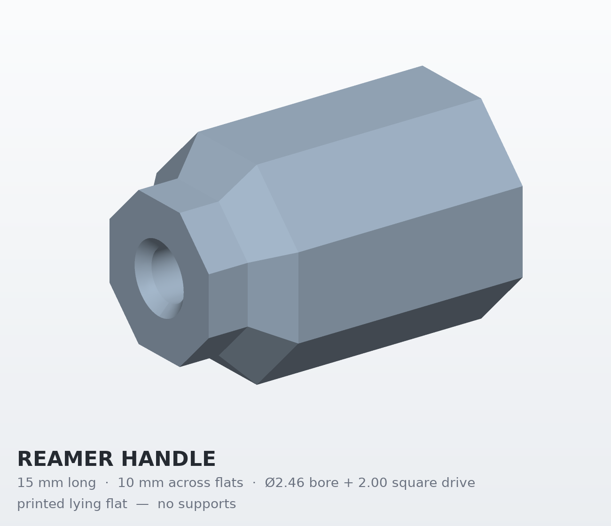

# 铰刀手柄 · Reamer Handle

给 Ø2.36 mm 刀柄的小铰刀做一个 3D 打印握把：15 mm 手捏段，正八棱柱，PETG 平放打印、全程免支撑。

插孔 Ø2.46 × 10 深，孔底一个 **2.00 见方的方孔**，与铰刀尾部的方头咬合 —— 扭矩靠形状传递，
不靠摩擦，不用胶、不用顶丝。

已实测：PETG 打印件装到位，推到底有硬限位，手铰传扭正常。

用 [build123d](https://github.com/gumyr/build123d) 代码化建模，改一个参数就能重出；
换一把刀只需加一个 `reamers/*.json`，代码不用动。



## 尺寸

下表是第一把刀（`reamers/r01-2.36.json`）的数，换刀只改档案，不改这里。

| 项目 | 值 | 参数名 |
|---|---|---|
| 总长（手捏段） | 15.00 mm | `length` |
| 对边距 | 10.00 mm | `across_flats` |
| 截面 | 正八边形，一平面朝下贴床 | `profile_rotation = 22.5` |
| 铰刀柄身 | Ø2.36（实测） | `shank_d` |
| 圆孔段 | Ø2.46 × 10.00 深 | `bore_d` = `shank_d` + 2 × `bore_clearance` |
| 孔底方孔 | 2.00 见方 × 2.00 深 | `square_clearance` / `square_len` |
| 铰刀方头 | 1.90 × 1.80 × 2.00 长，对角 Ø2.36 | `square_size` / `square_diag_meas` |
| 孔口倒角 | 0.50 × 45° | `mouth_chamfer` |
| 孔底壁厚 | 3.00 mm | `floor_thickness` |
| 孔口收口 | Ø7.00 A/F × 2.00 + 45° 锥 | `mouth_neck_flats` |
| 最小壁厚 | 3.77 mm | — |
| 体积 / 质量 | 1.06 cm³ / 1.35 g | `material = "PETG"` |


## 孔系

```
x = 0 ─────────────── 10.00 ────── 12.00 ── 15.00
    │  圆孔 Ø2.46      │ 方孔 2.00□  │ 孔底壁 3 │
    │  柄身 + 方头都过  │  方头卡这里  │  顶住它  │
```

| 段 | 作用 |
|---|---|
| 圆孔 Ø2.46 × 10 | 柄身单边 0.05，配合长 10 mm → 摆动 0.3°，扶正刀杆 |
| 方孔 2.00□ × 2 | 方头整根埋在里，四面贴面传扭；可传 0.11～0.29 N·m（手铰只需 0.03～0.10） |

孔径只看柄身：`2.36 + 2 × 0.05 = Ø2.46`。方头对角也是 2.36，和柄身一样粗，整根内切在柄身的
圆柱包络里，不会卡孔。方孔只看边长：`1.90 + 2 × 0.05 = 2.00` —— 方孔自带 45° 角，对角不用留。

## 设计要点

- **平放打印**：八边形躺下，一条 15 × 4.14 mm 的窄带贴床，两侧 45° 面正好在免支撑临界角。
- **孔顶 45° 泪滴 / 方孔 45° 尖顶**：水平孔的顶部若是一段平天花板，PETG 必然塌成腰形，
  刀和方头都塞不进。收成 45° 斜边后变成可打印的悬垂。
- **孔口收成小八边形**：端面从 10 收到 7，看清孔有没有对正，倒角也倒得干净。
- **孔底留 3 mm**：方头顶到底时靠它承力，纯受压不会顶穿。

## 打印（PETG）

| 项 | 值 |
|---|---|
| 姿态 | 平放，**不要旋转**，STL 已是打印姿态 |
| 支撑 | 不需要 |
| 喷嘴 / 热床 / 风扇 | 235～245 ℃ / 80 ℃ / 30～50 % |
| 层高 / 墙 / 顶底 / 填充 | 0.20 mm / 3 圈 / 4 层 / 15 % |
| 外壁速度 | ≤ 40 mm/s（想孔径更准就 30，别换来换去） |
| 附着 | **必须** 5 mm brim（贴床只有 15 × 4.14 的窄带） |
| 干燥 | 65 ℃ / 4 h。受潮会在孔壁拉一圈绒毛，孔径和方孔失真 |
| 脱模 | 光滑 PEI 涂一层胶棒 |

换 PLA 就把 `material` 改成 `"PLA"`，温度、风速、速度会跟着变。

## 装配

1. **冷透再装**，刚下机时材料还软。
2. **清孔**：掏掉孔口拉丝，刮掉方孔四角的毛刺，**孔底也要清** —— 一层象脚就能让方头顶不到底。
3. **插入**：方头先进，前 10 mm 是圆孔，很顺；**最后 2 mm 会顶住**，那是方头在等对角。
4. **轻转 10～20°**，感觉「咔」地沉下去，再推到底。
5. **验收**：推到底有硬限位，径向只剩几度余量。能自由转 360° 就是方头没进方孔，退出来重插。

别硬拧 —— 对不上角时方头的角顶在方孔入口，硬转会把入口啃圆。

## 换一把刀

一把刀一份档案，代码一行都不用改：

```bash
cp reamers/r01-2.36.json reamers/r02-2.80.json     # 文件名按柄径起，好认
# 改这几个实测数：shank_d、square_size、square_size_min、
#                square_tip_len、square_diag_meas、reamer_total_len

python codes/handle_build.py --reamer r02-2.80      # → output/r02-2.80/
python codes/render_preview.py --reamer r02-2.80    # → png/r02-2.80/
```

档案里**只写实测值**，外形尺寸、间隙、打印参数没写就用手柄默认值，
所以不用抄一整套。每把刀的输出各进各的目录，打完这把再回头打那把，参数不会互相顶掉。

**实测值 vs 算出来的**——档案里没有 `2.46` 这种数，因为它不是量出来的：

| 档案里写的（实测） | 代码算的（派生） |
|---|---|
| `shank_d` = 2.36 柄身圆柱直径 | 插孔 Ø2.46 = 2.36 + 2 × 0.05 |
| `square_size` = 1.90 方头边长 | 方孔 2.00 = 1.90 + 2 × 0.05 |
| `square_diag_meas` = 2.36 方头对角 | 方头过孔余量 = (2.46 − 2.36) / 2 = 0.05 |

> 两个 2.36 含义不同：一个是**圆柱柄身**的直径，一个是卡尺跨着两个角量出来的**方头包络圆**直径。
> 它俩相等，说明方头整根内切在柄身里，孔径只需要看柄身。

`0.05` 这个单边间隙（`bore_clearance`）属于手柄设计，所有刀共用；想更紧更松改它一个数就行。
随时可以看某份档案的「实测 → 派生」对照：

```bash
python codes/params.py --reamer r01-2.36
```

- 不带 `--reamer` 时用 `params.py` 里的 `DEFAULT_PROFILE`，目前是 `r01-2.36`。
- 键名写错会直接报错并列出可用键，不会静默忽略一个拼错的名字。
- 新刀的方头若不是矩形（六角、带锥度），把 `square_drive` 设成 `false` 退回纯圆孔方案。

## 改参数

```bash
pip install -r requirements.txt

python codes/handle_build.py      # 建模 + 自检 + 导出 STEP/STL
python codes/render_preview.py    # 重出 5 张预览图
```

所有尺寸在 `codes/params.py`，带注释。常用几个：

```bash
python codes/handle_build.py --set across_flats=11        # 粗一点
python codes/handle_build.py --set bore_clearance=0.03    # 柄身更紧（Ø2.42）
python codes/handle_build.py --set square_clearance=0.03  # 方孔更紧（1.96）
python codes/handle_build.py --set material=PLA
```

参数冲突（壁厚不足、方孔挡住柄身、孔顶破面等）会直接报错，不会静默出一个废件。

## 目录

```
├── reamers/                一把刀一份档案（只写实测数）
│   └── r01-2.36.json
├── codes/
│   ├── params.py           ← 手柄设计本身：外形 / 间隙 / 打印参数
│   ├── handle_build.py     ← 建模 + 自检 + 导出
│   └── render_preview.py   ← 出图（独立文件）
├── output/r01-2.36/        reamer_handle.step / .stl / .3mf / print_notes.txt
├── png/r01-2.36/           5 张预览图
├── requirements.txt
└── LICENSE
```

## 已知限制

- 换刀不改代码：把 `reamers/r01-2.36.json` 另存一份，改 `shank_d`、`square_size`、
  `square_size_min`、`square_tip_len`、`square_diag_meas`、`reamer_total_len`，再带 `--reamer` 跑。
- 别指望压入锁死：FDM 手压配合做不到 0.02 以内，低于 0.02 大概率插不进。
- PETG 长期受扭会有轻微冷流，旷量缓慢变大；但方孔是挡块结构，不会突然失效。
- 方头若不是矩形（六角、带锥度），这套方孔不适用。

## License

MIT
